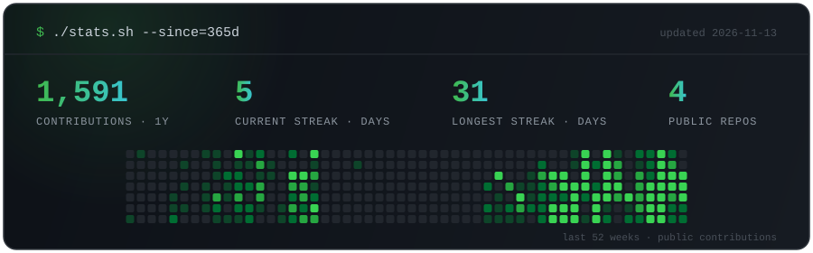

<div align="center">
  
</div>

<p align="center">
  
  
  
  
  
  
</p>

```console
lupenghan@qiniu ~ % whoami
Lupeng Han — backend engineer, currently at Qiniu.
lupenghan@qiniu ~ % pwd
Shanghai, China
```

## `$ cat about.md`

Backend engineer at [Qiniu](https://www.qiniu.com). I work on services and the infrastructure underneath them, and lately a lot of LLM infrastructure and agent tooling.

> 在[七牛云](https://www.qiniu.com)做后端工程。日常在服务端与基础设施之间来回，最近在关注 LLM 基础设施、Agent 工具链和 MCP 生态。

## `$ cat ~/.focus`

| area | 关注点 |
| :-- | :-- |
| `infra` | 服务端、稳定性与性能 · service reliability & performance |
| `llm` | 推理服务的部署与调度 · inference deployment & scheduling |
| `agent` | MCP、工具链与自动化 · MCP, tooling & automation |

## `$ gh repo list`

Forked, read, and sometimes hacked on — 会 fork 下来读、跑、改的仓库：

| repo | 说明 |
| :-- | :-- |
| [**emdash**](https://github.com/LUPENGHAN/emdash) | 并行跑多个 coding agent 的开发环境<br/><sub>Agentic development environment · TypeScript</sub> |
| [**AstrLink**](https://github.com/LUPENGHAN/AstrLink) | 统一订阅与 API 的本地 AI 网关<br/><sub>Local AI gateway for agents · Go</sub> |
| [**xiaozhi-esp32**](https://github.com/LUPENGHAN/xiaozhi-esp32) | 基于 MCP 的语音聊天机器人<br/><sub>MCP-based chatbot</sub> |

## `$ ./stats.sh --since=365d`

<p align="center">
  
</p>

## `$ watch -n 86400 ./contributions.sh`

<p align="center">
  <picture>
    <source media="(prefers-color-scheme: dark)" srcset="https://raw.githubusercontent.com/LUPENGHAN/LUPENGHAN/output/github-snake-dark.svg" />
    <source media="(prefers-color-scheme: light)" srcset="https://raw.githubusercontent.com/LUPENGHAN/LUPENGHAN/output/github-snake.svg" />
    
  </picture>
</p>

## `$ exit`

```console
lupenghan@qiniu ~ % echo "thanks for stopping by"
thanks for stopping by
lupenghan@qiniu ~ % exit
```

<sub>Stats and the snake are regenerated daily by GitHub Actions. 统计卡片与贡献蛇每天自动更新。</sub>
